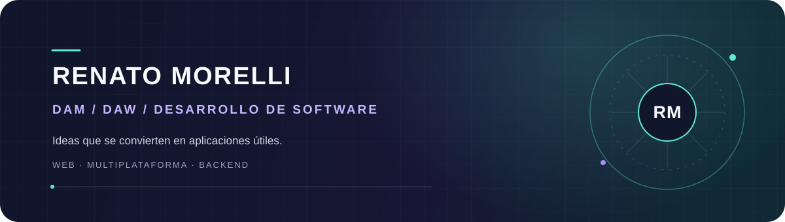

  

<h1 align="center">Hola, soy Renato 👋</h1>

  Estudiante de <strong>Desarrollo de Aplicaciones Multiplataforma (DAM)</strong> y
  <strong>Desarrollo de Aplicaciones Web (DAW)</strong>. 
  Me gusta convertir ideas en productos útiles, cuidando tanto la experiencia de usuario como la lógica que hay detrás.

  <code>JavaScript</code> &nbsp; <code>React Native</code> &nbsp; <code>Expo</code> &nbsp;
  <code>Python</code> &nbsp; <code>Flask</code> &nbsp; <code>Node.js</code> &nbsp;
  <code>SQLite</code> &nbsp; <code>HTML · CSS</code>

## Un poco sobre mí

- 🎓 Aprendiendo desarrollo web y multiplataforma en DAM y DAW.
- 🛠️ Disfruto trabajando en proyectos completos: interfaz, API y persistencia de datos.
- 📱 Me interesa crear aplicaciones accesibles desde distintos dispositivos y fáciles de usar.
- 🌱 Siempre buscando aprender, probar ideas y mejorar lo que construyo.

## Proyectos destacados

### 🥊 Ikigai — gestión de clases de boxeo

Aplicación multiplataforma para una escuela de boxeo. Permite consultar horarios y gestionar reservas, aforo y tarifas; está pensada para que alumnos y responsables tengan una experiencia sencilla desde móvil o navegador.

**Tecnologías:** React Native, Expo, JavaScript, Node.js, Express y SQLite.  
**Demo web:** [ikigai.34-175-131-239.nip.io](https://ikigai.34-175-131-239.nip.io)

### 🌌 EXODIA — espacio social todo en uno

Aplicación de escritorio y navegador que reúne en una sola experiencia un feed, vídeos cortos, foros, música y perfiles. Un proyecto para explorar cómo organizar distintas formas de compartir y descubrir contenido.

**Tecnologías:** Python, Flask, SQLite, HTML, CSS y JavaScript.

> Los repositorios de estos proyectos son privados. En una entrevista puedo enseñar las demos disponibles y explicar las decisiones técnicas y el proceso de desarrollo.

## ¿Conectamos?

Puedes escribirme desde [mi perfil de GitHub](https://github.com/ronato36).  
Estoy encantado de hablar sobre desarrollo web, aplicaciones multiplataforma y proyectos en los que seguir aprendiendo.
